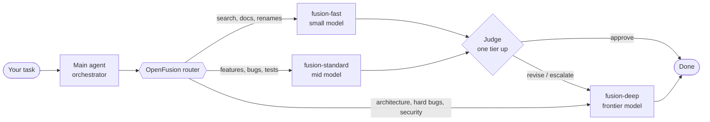

<div align="center">

# OpenFusion

**Stop paying frontier-model prices for grep.**

[](https://github.com/calesthio/OpenFusion/blob/main/LICENSE)


[](https://github.com/calesthio/OpenFusion)

</div>

> **Agents and developers:** you don't have to burn tokens running your premium model on every task.
> Renaming a variable doesn't need Opus. Finding a file doesn't need GPT-6 Astra. Summarizing docs doesn't
> need your most expensive reasoning budget. But the race condition in your job queue? That one does.
>
> **Introducing OpenFusion**: multi-model routing for any AI coding agent.

OpenFusion routes **each subtask to the cheapest model that can do it well**, and has a **judge escalate to
a stronger model** when the cheap attempt isn't good enough. Your main agent stays in charge of the plan and
the final answer; small, fast models do the grunt work; your frontier model only shows up where it matters.

- **One skill, every harness.** Claude Code, Codex, GitHub Copilot, Cursor, Gemini CLI, Google Antigravity,
  OpenCode, or any agent that reads `AGENTS.md`.
- **Three tiers, three patterns.** `fast` / `standard` / `deep` models, run as `single`, `cascade`
  (draft → judge → escalate) or `critique` (draft → parallel critics → revise).
- **Quality guardrails built in.** Cheap work gets reviewed. Failing tests, tool loops or a "revise" verdict
  move the task up a tier automatically.
- **Cache-friendly.** The main thread stays on one model, so your prompt cache stays warm.
- **Zero runtime dependencies.** The router bundled into each skill is plain Python 3.9+. No servers, no API
  keys, no proxy. Your agent's own subagents do the work on the models you already pay for.
- **Runs everywhere.** Same output, byte-for-byte, on macOS, Linux and Windows.

---

## How it works



1. **Route.** The orchestrator skill runs the bundled router on each subtask. It classifies the work
   (lookup, docs, feature, refactor, hard debugging, security, architecture…) and picks a tier and a pattern.
2. **Delegate, but only when it pays.** Bulk, well-scoped subtasks (research sweeps, boilerplate, batches of
   tests) go to a cheaper `fusion-*` subagent with a self-contained brief. Work on the main model's own tier
   (deep, by default), small tasks and reviews stay in the main thread: the router says `run_in: main`.
   At most 3 workers per task, spawned in one batch and collected once, never polled.
3. **Review.** In `cascade`, a read-only judge one tier up returns a JSON verdict: approve or revise, with
   a concrete defect. In `critique`, 2 to 4 critics review in parallel and the drafter revises once.
4. **Escalate.** A revise verdict, tests still failing, a tool loop, low confidence or a context overflow
   sends the task up the ladder: `fast → standard → deep`.

## 60-second quickstart

You need **Python 3.9+** ([python.org](https://www.python.org/downloads/); on Windows tick *Add python.exe to PATH*).
OpenFusion has **zero runtime dependencies** and writes files **only** into the repo you name.

From inside your repo, with [uv](https://docs.astral.sh/uv/):

```bash
uvx openfusion install claude-code .
```

Or install the `openfusion` command once:

```bash
pipx install openfusion        # or: pip install openfusion   /   uv tool install openfusion
openfusion install claude-code ~/code/your-repo
```

> **Not on PyPI yet?** The commands above work once `openfusion` is published there (maintainers: see
> [DEVELOPMENT.md → Publishing to PyPI](https://github.com/calesthio/OpenFusion/blob/main/DEVELOPMENT.md#publishing-to-pypi)). Until then, run it straight from GitHub:
> `uvx --from git+https://github.com/calesthio/OpenFusion openfusion install claude-code .`
> (or `pipx install git+https://github.com/calesthio/OpenFusion`), or use the scripts below.

**Alternative: clone and run the script** (needs only Python, no packages)

```bash
git clone https://github.com/calesthio/OpenFusion.git OpenFusion
./OpenFusion/install.sh claude-code ~/code/your-repo
```

```powershell
git clone https://github.com/calesthio/OpenFusion.git OpenFusion
powershell -ExecutionPolicy Bypass -File .\OpenFusion\install.ps1 claude-code C:\path\to\your\repo
```

Swap `claude-code` for `codex`, `github-copilot`, `cursor`, `gemini-cli`, `antigravity`, `opencode` or `generic`
(`openfusion list-harnesses` prints them; `openfusion --version` shows what you're running).
Then open your repo in that tool and give it something non-trivial. That's it.

Want to see a routing decision first?

```bash
python .claude/skills/openfusion/scripts/route.py "fix the flaky race in the job queue"
# hard_debugging: deep -> opus (single, confidence 0.38)
```

| Flag | Effect |
|---|---|
| `--no-instructions` | don't touch `CLAUDE.md` / `AGENTS.md` / `GEMINI.md`; write `CLAUDE.openfusion.md` etc. to paste yourself |
| `--codex-profiles` | Codex only: also copy `fusion-<tier>.config.toml` profiles into `~/.codex/` (never overwrites) |
| `--available MODELS` | comma list or `@file` of models you can use; each tier gets its first available candidate (repeatable) |
| `--available-cmd CMD` | same, read from a command's output, e.g. `"opencode models"` |

Re-running is safe: the instructions block sits between `<!-- openfusion:start -->` / `<!-- openfusion:end -->`
markers and is replaced, never duplicated. Use several tools? Run the installer once per tool. (Codex,
Antigravity and generic share `.agents/skills/openfusion/`, so pick one of those three per repo.)

From a checkout without installing anything: `python run_openfusion.py install <tool> <repo>`.

## For agents

If you are an AI agent asked to set up OpenFusion in a repository, follow these steps exactly:

1. Identify your harness name: one of `claude-code`, `codex`, `github-copilot`, `cursor`, `gemini-cli`,
   `antigravity`, `opencode`. If you are none of these, use `generic`.
2. Install into the target repo (absolute path), using the first option that works:
   - `uvx openfusion install <harness> <repo>` (or `pipx run openfusion install <harness> <repo>`)
   - not on PyPI yet: `uvx --from git+https://github.com/calesthio/OpenFusion openfusion install <harness> <repo>`
   - no uv/pipx: `git clone https://github.com/calesthio/OpenFusion.git <tmp>/OpenFusion` (outside the target repo), then
     `<tmp>/OpenFusion/install.sh <harness> <repo>` or, on Windows,
     `powershell -ExecutionPolicy Bypass -File <tmp>\OpenFusion\install.ps1 <harness> <repo>`
3. Check `openfusion --version` / `openfusion list-harnesses` if anything looks off.
4. Verify: `python <repo>/<skill_dir>/scripts/route.py "rename foo to bar"` should print a `fast` route.
   `<skill_dir>` is printed by the installer (for example `.claude/skills/openfusion`).
5. Check the model names (`openfusion tiers`, or `core/openfusion.yaml` → `providers.<harness>` in a checkout)
   match models you can actually use. If not, re-run step 2 with `--available <models>`, or save
   `openfusion config > my.yaml`, edit it and re-run with `openfusion --config my.yaml install ...`.
6. Tell the user which files were added, and that new sessions will route work through the `fusion-*` subagents.
   Some tools need a reload to pick up new subagents (Gemini CLI: `/agents reload`).

When you are *using* OpenFusion, the installed `openfusion` skill is your playbook: route first, delegate with
a self-contained brief, have cheap drafts judged, escalate on failure, and keep the final answer yourself.

## Customize

Everything is driven by **`core/openfusion.yaml`**. In a checkout, edit it and re-run the installer
(or `openfusion render all --out adapters` to refresh the checked-in reference output). With the installed
package, export it first: `openfusion config > my.yaml` (or `config --json > my.json`, which needs no PyYAML),
edit, then `openfusion --config my.yaml install <tool> <repo>`. Reading an edited YAML needs PyYAML:
`pip install "openfusion[yaml]"` or `uvx --with pyyaml openfusion ...`.

- **Models:** `providers.<tool>.<tier>` takes `candidates: [best, next, ...]` (or a single `model`) and optional
  `effort`. Check what resolves with `openfusion resolve --provider <tool> --available <your models>`.
  Updating models step by step: [DEVELOPMENT.md](https://github.com/calesthio/OpenFusion/blob/main/DEVELOPMENT.md#updating-models).
- **Tiers:** `tiers` and `escalation_ladder`. Add a tier and give every provider a model for it.
- **Routing:** `intent_rules` (regex, checked first), `categories` (keywords, `tier`, `min_tier`, `pattern`),
  `signals` (nudge a tier up or down), `effort_levels` (`standard` / `high` / `max`).
- **Patterns:** `patterns.cascade` (judge one tier up, max escalations), `patterns.critique` (critic tier and count).
- **Optional LLM classifier:** `classifier.command` is any shell command that reads the task on stdin and prints
  `{"category": ..., "confidence": ...}`. On any failure, routing falls back to the rules.
- **Prompts:** `core/prompts/*.md` and `core/prompts/roles.yaml` (role descriptions decide when a tool delegates).

Check changes with `openfusion tiers`, `openfusion route --provider <tool> "<task>"` and `pytest`.

## Project layout

```
core/                         ← the only thing you edit
  openfusion.yaml             tiers, routing rules, patterns, tier→model map per tool
  skill/SKILL.md              the orchestrator playbook (one template for all tools)
  prompts/                    worker / judge / critic / classifier prompts, role descriptions
  router/openfusion/          router + renderer + CLI (pure Python, zero dependencies)
    _data/                    GENERATED JSON snapshots of the YAML (so no PyYAML is needed)
adapters/<tool>/              GENERATED, checked in so you can browse exactly what gets installed
pyproject.toml                the `openfusion` package (core/ and adapters/ ship inside the wheel)
install.sh / install.ps1      thin wrappers: run `openfusion install` from a checkout
run_openfusion.py             run the CLI from a checkout without installing
.github/workflows/            CI on Windows/macOS/Linux; publish to PyPI on a version tag
tests/                        pytest suite (router, judge, models, every adapter, installer logic)
docs/HARNESSES.md             per-tool formats, caveats and the dated model table
DEVELOPMENT.md                how to change and release OpenFusion
```

One common core, thin adapters: a routing rule or prompt fix lands in `core/` once and reaches every tool on
re-render. Adapters only decide file locations and how model names are written.

## FAQ

**Does OpenFusion call models itself or need API keys?**
No. It configures your harness's own subagents. Your tool runs them on the models and plan you already have.

**Can it switch the main agent's model mid-session?**
No harness allows that reliably, and it would break the prompt cache. OpenFusion keeps the main thread on one
model and moves the *work* to subagents on other models.

**Will cheap models make my results worse?**
That's what the judge is for. In `cascade`, a stronger model reviews the cheap draft and escalates when it finds a
concrete defect. Security, architecture and hard debugging route to `deep` by default.

**How does the router decide?**
Fast, transparent regex and keyword rules plus complexity signals, all in `core/openfusion.yaml`. You can plug
in an LLM classifier for low-confidence cases; it always falls back to the rules.

**My tool isn't listed.**
Use the `generic` adapter, or add a real one: add `providers.<tool>` to the YAML, write one small function in
`core/router/openfusion/render.py`, add a `Harness(...)` entry, and run the tests. The suite automatically checks
every harness for filled placeholders, deterministic output, the bundled router and idempotent install.

**Claude Code has Opus 5.5 and Opus 5. Does `opus` pick the right one?**
Yes. `opus` is an alias that Claude Code resolves to the newest Opus your provider serves (Opus 5.5 on the
Anthropic API as of Oct 2026), so a subagent with `model: opus` gets 5.5 without naming it. Two catches:
your CLI must be new enough to know the model (`claude update`), and on Bedrock, Vertex or Foundry the
aliases can lag behind. To pin a version, set `OPENFUSION_MODEL_CLAUDE_CODE_DEEP=claude-opus-5-5` and re-install.

**Do I have to use all three tiers?**
No. Point two tiers at the same model, or edit `escalation_ladder`.

## Contributing

PRs are welcome. Start with **[DEVELOPMENT.md](https://github.com/calesthio/OpenFusion/blob/main/DEVELOPMENT.md)**: architecture, updating models, adding a
harness, tests on every OS and the release checklist. Especially welcome:

- live verification reports from inside each harness (what loaded, what didn't),
- corrected model IDs as vendors ship new ones,
- new harness adapters,
- better routing rules, backed by examples.

```bash
python -m venv .venv && . .venv/bin/activate      # Windows: .venv\Scripts\Activate.ps1
pip install -e ".[test]"
pytest
openfusion render all --out adapters              # after any core/ change; a test fails if you forget
```

## License

[MIT](https://github.com/calesthio/OpenFusion/blob/main/LICENSE) © 2026 [calesthio/OpenFusion](https://github.com/calesthio/OpenFusion)

---

<div align="center">

⭐ **If OpenFusion saved you tokens, drop a star — it helps others find it too.**

</div>
